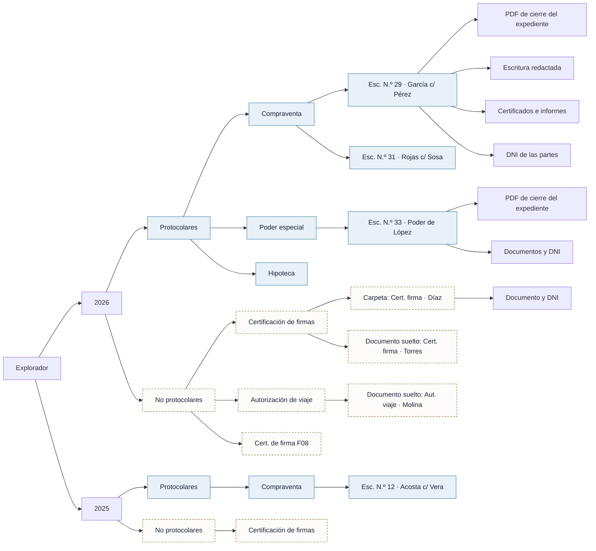

# Árbol de carpetas del Explorador — ejemplo (20/11/2026)

Boceto de lo que describió Lucas: por año, dentro de cada año protocolares y no protocolares, y dentro de cada uno una carpeta por acto jurídico. Los protocolares siempre tienen carpeta armada; los no protocolares pueden o no tenerla.

**Es un ejemplo de estructura, no una pantalla.** La clasificación de qué acto es protocolar y cuál no es una suposición mía a confirmar con Fátima: hoy el producto no guarda esa distinción.

**Cómo leerlo**
- Azul: protocolar. Siempre tiene su carpeta completa (PDF de cierre, escritura, certificados, DNI de las partes).
- Borde punteado: no protocolar. Puede tener carpeta («Cert. firma · Díaz») o ser solo un documento suelto («Cert. firma · Torres»).
- Los nombres de actos salen de las plantillas que ya existen en el producto (Compraventa, Poder especial, Hipoteca, Cert. firma, Aut. viaje, Cert. F08). Los números de escritura y los apellidos son inventados.

**Decisión final (Lucas, 20/11/26): NO se hace un árbol de carpetas; se hace un sistema de filtros.** Se sigue D26. El orden de este boceto se conserva como **ruta visible** sobre los filtros (año › protocolar o no › acto), con la misma lógica que el papel pero sin árbol. Los filtros del Explorador incluyen: año, protocolar / no protocolar, acto jurídico, persona, estado, y con o sin carpeta.
